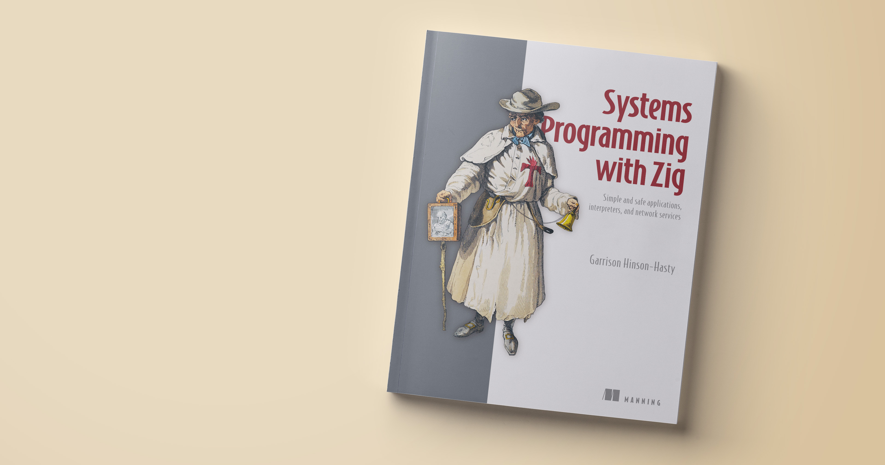

# Systems Programming with Zig - Code & Supplemental Materials

Thanks for buying my book, or at least being curious about it!

Here you can find code for the book's major projects. This includes supplemental materials, like the wordlist and static webpage for chapter 4. For chapters with self-contained code listings, I've organized them in the [`listings`](./listings/) directory. They come with a handy build script!

All code compiles for Zig 0.17.0. If you're using Zig master, you may need to make modifications to get things working.

For errata, I'm happy to accept issues here. If you are looking for help with the text (or with Zig), [the book forum](https://livebook.manning.com/forum?product=hinsonhasty) is a better place to ask.

If you would like to contact me for any reason (and you are not a webscraper or an AI agent), I can be reached at garrisonhh (at) pm (dot) me.
